# Plan comparison algorithm: step-by-step illustrations

Generated by `report_figures/make_figures.py`. Every output below was produced by running the project code. PostgreSQL plans come from `EXPLAIN (FORMAT JSON)` on the local TPC-H database. AI plans in steps 1 to 6 and in the gallery are **hand-written for illustration**; the worked example uses a **real Gemini reply** read from `.llm_cache`.

Running example for steps 1 to 6: query 3 from `example_queries.sql` (TPC-H Q14):

```sql
SELECT 100.00 * sum(case when p_type like 'PROMO%'
                         then l_extendedprice * (1 - l_discount) else 0 end)
       / sum(l_extendedprice * (1 - l_discount)) AS promo_revenue
FROM lineitem, part
WHERE l_partkey = p_partkey
  AND l_shipdate >= date '1993-11-01'
  AND l_shipdate < date '1993-11-01' + interval '1' month;
```

## Step 1: Parse both plans into PlanNode trees (`preprocessing.plan_from_dict`)

PostgreSQL's EXPLAIN output has many fields (costs, row estimates, widths, parallel flags). Only the fields that describe *what* the plan does are kept. Here is the root node exactly as PostgreSQL returns it (children removed):

```json
{
  "Node Type": "Aggregate",
  "Strategy": "Plain",
  "Partial Mode": "Finalize",
  "Parallel Aware": false,
  "Async Capable": false,
  "Startup Cost": 16967.24,
  "Total Cost": 16967.26,
  "Plan Rows": 1,
  "Plan Width": 32,
  "Disabled": false
}
```

After `plan_from_dict`:

```json
{
  "node_type": "Aggregate",
  "partial_mode": "Finalize",
  "children": 1
}
```

PostgreSQL reports every aggregate as `Aggregate` with a separate `Strategy`. It is renamed so that it can be compared with the node names an LLM uses:

```python
# PostgreSQL reports every aggregate as "Aggregate" with a separate Strategy
if node_type == "Aggregate":
    strategy = str(plan_dict.get("Strategy", "")).lower()
    if strategy.startswith("hash"):
        node_type = "HashAggregate"
    elif strategy.startswith("sort"):
        node_type = "GroupAggregate"
```

The AI reply goes through the same function. `normalize_node_type` maps the LLM's own wording to PostgreSQL names, and predicates from any condition key are merged into `selection` or `join_cond`:

| LLM node (JSON) | Parsed fields |
|---|---|
| `{"Node Type": "Sequential Scan", "Relation Name": "part"}` | `{"node_type": "Seq Scan", "relation": "part", "children": 0}` |
| `{"Node Type": "hash join", "Join Type": "Inner", "Condition": "l.l_partkey = p.p_partkey"}` | `{"node_type": "Hash Join", "join_type": "Inner", "join_cond": "l.l_partkey = p.p_partkey", "children": 0}` |
| `{"Node Type": "Hash Aggregate"}` | `{"node_type": "HashAggregate", "children": 0}` |
| `{"Node Type": "Full Table Scan", "Relation Name": "orders"}` | `{"node_type": "Seq Scan", "relation": "orders", "children": 0}` |

Both trees as text (`preprocessing.plan_to_text`):

```
PostgreSQL plan:
Aggregate
  Gather
    Aggregate
      Hash Join  (Hash Cond: (lineitem.l_partkey = part.p_partkey))
        Seq Scan [lineitem]  (Filter: ((l_shipdate >= '1993-11-01'::date) AND (l_shipdate < '1993-12-01 00:00:00'::timestamp without time zone)))
        Hash
          Seq Scan [part]

AI plan:
Aggregate
  Hash Join  (Hash Cond: l_partkey = p_partkey)
    Index Scan [lineitem] using idx_lineitem_shipdate  (Index Cond: l_shipdate >= '1993-11-01' AND l_shipdate < '1993-12-01')
    Hash
      Seq Scan [part]
```

## Step 2: Leave out helper nodes (`comparison.is_ignored`)

```python
def is_ignored(node: PlanNode) -> bool:
    return node.node_type in IGNORED_NODE_TYPES or node.partial_mode == "Partial"
```

```python
IGNORED_NODE_TYPES = ['Bitmap Index Scan', 'Gather', 'Gather Merge', 'Hash', 'Parallel Hash']
```

| Node (PostgreSQL plan) | Partial Mode | Compared? | Why |
|---|---|---|---|
| Aggregate | Finalize | yes | |
| Gather |  | no | parallelism helper, not a relational operator |
| Aggregate | Partial | no | partial aggregate; compared through its Finalize partner |
| Hash Join |  | yes | |
| Seq Scan [lineitem] |  | yes | |
| Hash |  | no | build phase of its parent Hash Join; compared through the join |
| Seq Scan [part] |  | yes | |

## Step 3: Give every compared node a matching key (`comparison.keyed_nodes`)

```python
def category(node_type: str) -> str:
    if node_type in SCAN_TYPES:
        return "scan"
    if node_type in JOIN_TYPES:
        return "join"
    if node_type in AGGREGATE_TYPES:
        return "aggregate"
    return node_type


def keyed_nodes(root: PlanNode) -> dict:
    seen: dict = {}
    keyed: dict = {}                    # (base key, occurrence) -> node
    for node in root.walk():
        if is_ignored(node):
            continue
        cat = category(node.node_type)
        # scans are keyed by their table, other nodes by category and the tables beneath them
        base = ("scan", node.relation) if cat == "scan" else (cat, node.tables())
        # the occurrence number keeps repeated keys apart
        occurrence = seen.get(base, 0)
        seen[base] = occurrence + 1
        keyed[(base, occurrence)] = node
    return keyed
```

**PostgreSQL plan**

```
(aggregate, {lineitem, part})                 -> Aggregate
(join, {lineitem, part})                      -> Hash Join
(scan, lineitem)                              -> Seq Scan [lineitem]
(scan, part)                                  -> Seq Scan [part]
```

**AI plan**

```
(aggregate, {lineitem, part})                 -> Aggregate
(join, {lineitem, part})                      -> Hash Join
(scan, lineitem)                              -> Index Scan [lineitem] (idx_lineitem_shipdate)
(scan, part)                                  -> Seq Scan [part]
```

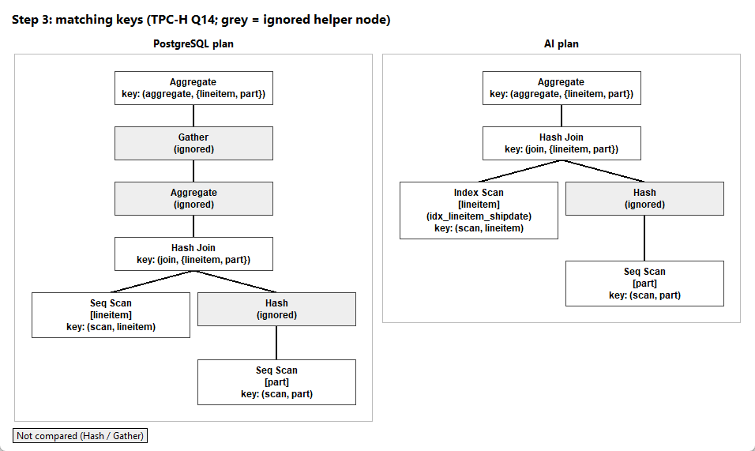

*Figure: matching key of every compared node. Grey nodes are left out (step 2).*

**Repeated keys.** When the same table is scanned twice (a self-join), the occurrence number keeps the two scans apart. Real PostgreSQL plan for:

```sql
SELECT n1.n_name, n2.n_name FROM nation n1 JOIN nation n2 ON n1.n_regionkey = n2.n_regionkey WHERE n1.n_nationkey < n2.n_nationkey
```

```
(join, {nation})                              -> Hash Join
(scan, nation)                                -> Seq Scan [nation]
(scan, nation) #1                             -> Seq Scan [nation]
```

## Step 4: Match nodes by key

Both plans are now dictionaries `{key: node}`. A key in both is a **matched** pair, a key only in PostgreSQL's plan is **missing**, and a key only in the AI plan is **extra**. Each lookup is one dictionary access.

| Key | PostgreSQL node | AI node | Outcome |
|---|---|---|---|
| `(aggregate, {lineitem, part})` | Aggregate | Aggregate | matched |
| `(join, {lineitem, part})` | Hash Join | Hash Join | matched |
| `(scan, lineitem)` | Seq Scan | Index Scan | matched |
| `(scan, part)` | Seq Scan | Seq Scan | matched |

## Step 5: Normalise predicates before comparing them

The two plans write the same predicate differently: PostgreSQL adds brackets, `::type` casts and table qualifiers, while the LLM usually does not. Predicates are split on top-level `AND`s and reduced to **column names**; literal values are ignored.

```
_split_and("((l_shipdate >= '1993-11-01'::date) AND (l_shipdate < '1993-12-01 00:00:00'::timestamp without time zone))")
  -> ["(l_shipdate >= '1993-11-01'::date)", "(l_shipdate < '1993-12-01 00:00:00'::timestamp without time zone)"]
selection_columns(...)
  -> ['l_shipdate']

_split_and("l_shipdate >= '1993-11-01' AND l_shipdate < '1993-12-01'")
  -> ["l_shipdate >= '1993-11-01'", "l_shipdate < '1993-12-01'"]
selection_columns(...)
  -> ['l_shipdate']

_split_and("((c_mktsegment = 'BUILDING'::bpchar) OR (c_acctbal > '0'::numeric))")
  -> ["((c_mktsegment = 'BUILDING'::bpchar) OR (c_acctbal > '0'::numeric))"]
selection_columns(...)
  -> ['c_acctbal', 'c_mktsegment']

_split_and('(l_orderkey = orders.o_orderkey)')
  -> ['(l_orderkey = orders.o_orderkey)']
selection_columns(...)
  -> []

_split_and('(lineitem.l_partkey = part.p_partkey)')
  -> ['(lineitem.l_partkey = part.p_partkey)']
join_pairs(...)
  -> [('l_partkey', 'p_partkey')]

_split_and('p.p_partkey = l.l_partkey')
  -> ['p.p_partkey = l.l_partkey']
join_pairs(...)
  -> [('l_partkey', 'p_partkey')]

_split_and('((lineitem.l_suppkey = supplier.s_suppkey) AND (customer.c_nationkey = supplier.s_nationkey))')
  -> ['(lineitem.l_suppkey = supplier.s_suppkey)', '(customer.c_nationkey = supplier.s_nationkey)']
join_pairs(...)
  -> [('c_nationkey', 's_nationkey'), ('l_suppkey', 's_suppkey')]
```

A column-to-column predicate inside a scan (e.g. the `Index Cond` of the inner side of a Nested Loop) is not a filter, so `selection_columns` skips it; it is a join predicate.

## Step 6: Classify each matched pair (`comparison.classify_matched`)

Each matched pair is checked according to its category. Unmatched nodes are described by `describe_unmatched` (a join with no partner is reported as `join_order`). One example per difference kind follows. All figures use the GUI's colours.

**Running example (Q14):**

```
1. [scan_method] Table 'lineitem': PostgreSQL uses Seq Scan, the AI plan uses Index Scan on index idx_lineitem_shipdate.

Difference rate = (changed 1 + missing 0 + extra 0) / (matched 4 + missing 0 + extra 0) = 25%
```

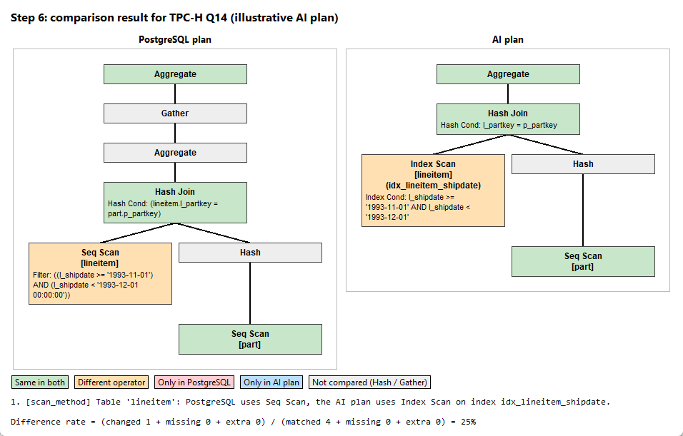

### Gallery: one example per difference kind

| Kind | Category | Reported when |
|---|---|---|
| `scan_method` | scan | operator or index differs |
| `scan_condition` | scan | the set of filtered columns differs |
| `join_algorithm` | join | Hash Join / Merge Join / Nested Loop differs |
| `join_type` | join | same algorithm, both state a join type, and it differs |
| `join_sides` | join | same Hash Join / Nested Loop, but the first (probe / outer) child covers different tables |
| `join_condition` | join | both give a join predicate and the column pairs differ |
| `aggregate_strategy` | aggregate | Aggregate / HashAggregate / GroupAggregate differs |
| `join_order` | unmatched join | a join's set of tables exists only in one plan |
| `operator_missing` / `operator_extra` | unmatched other | any other node only in one plan |

#### scan_method

Both scans are keyed (scan, orders), so they are matched. The filter column is the same (o_orderkey) even though PostgreSQL puts it in Index Cond and the AI in Filter, so only the access path is reported.

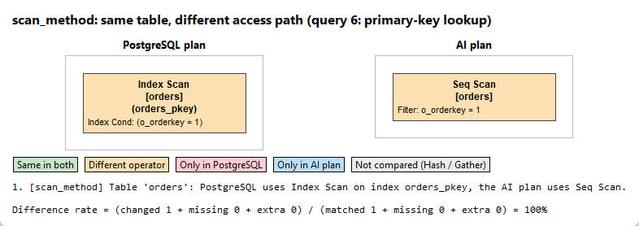

```
1. [scan_method] Table 'orders': PostgreSQL uses Index Scan on index orders_pkey, the AI plan uses Seq Scan.

Difference rate = (changed 1 + missing 0 + extra 0) / (matched 1 + missing 0 + extra 0) = 100%
```

#### scan_condition

Literal values, ::casts and brackets are ignored; only the set of filtered columns is compared. Gather and the Partial aggregate are helper nodes (grey), so the Finalize aggregate matches the AI's single Aggregate.

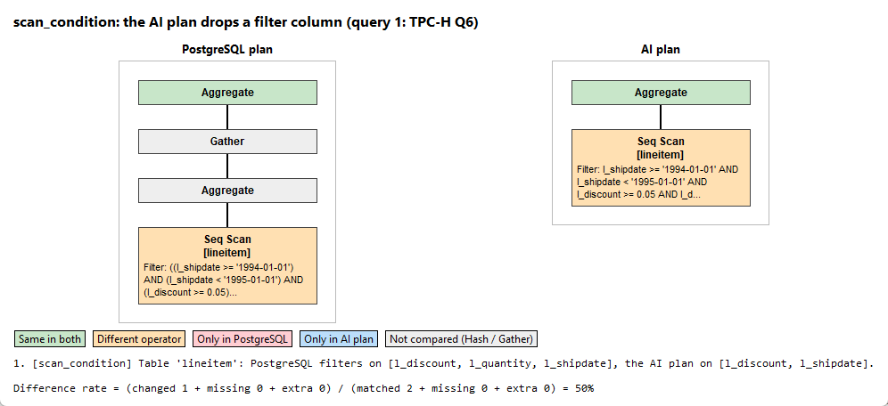

```
1. [scan_condition] Table 'lineitem': PostgreSQL filters on [l_discount, l_quantity, l_shipdate], the AI plan on [l_discount, l_shipdate].

Difference rate = (changed 1 + missing 0 + extra 0) / (matched 2 + missing 0 + extra 0) = 50%
```

#### join_algorithm

The top joins are both keyed (join, {customer, lineitem, orders}) and so are matched even though the algorithm differs. The AI also reads lineitem with a Seq Scan instead of the Index Scan PostgreSQL uses on the inner side of its Nested Loop, so that scan is changed too.

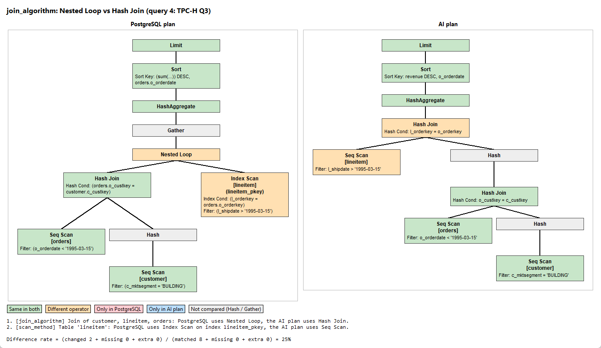

```
1. [join_algorithm] Join of customer, lineitem, orders: PostgreSQL uses Nested Loop, the AI plan uses Hash Join.
2. [scan_method] Table 'lineitem': PostgreSQL uses Index Scan on index lineitem_pkey, the AI plan uses Seq Scan.

Difference rate = (changed 2 + missing 0 + extra 0) / (matched 8 + missing 0 + extra 0) = 25%
```

#### join_type

The join type is only compared when both plans use the same algorithm and both state a join type. Here the AI turned the LEFT JOIN into an inner join.

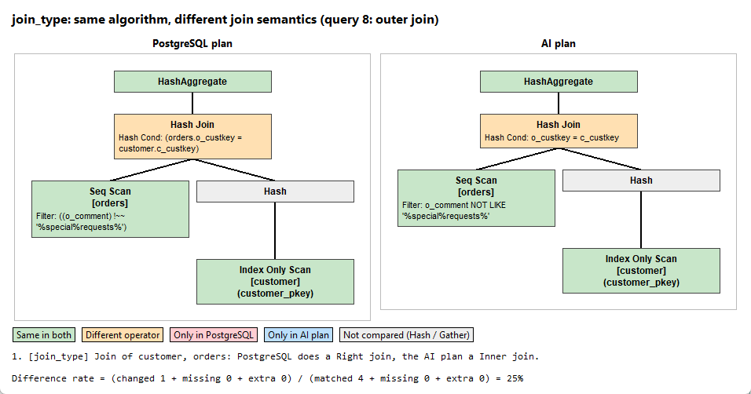

```
1. [join_type] Join of customer, orders: PostgreSQL does a Right join, the AI plan a Inner join.

Difference rate = (changed 1 + missing 0 + extra 0) / (matched 4 + missing 0 + extra 0) = 25%
```

#### join_sides

For a Hash Join the first child is the probe side and the Hash child is the build side. PostgreSQL hashes the small part table; the AI hashes lineitem. The join condition is written the other way round (p = l instead of l = p) but is still recognised as the same pair.

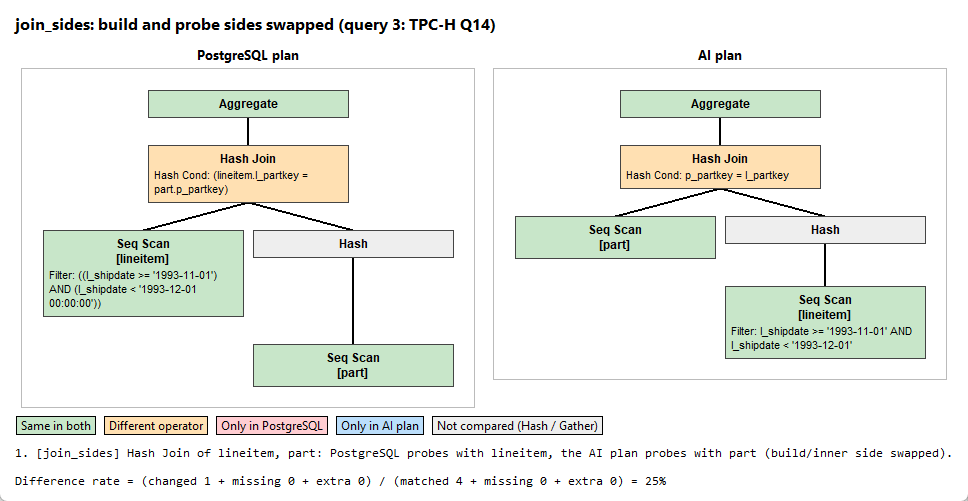

```
1. [join_sides] Hash Join of lineitem, part: PostgreSQL probes with lineitem, the AI plan probes with part (build/inner side swapped).

Difference rate = (changed 1 + missing 0 + extra 0) / (matched 4 + missing 0 + extra 0) = 25%
```

#### join_condition

Join predicates are reduced to sorted column pairs, so table qualifiers and the order of the two sides do not matter. The AI plan is missing the (l_suppkey, ps_suppkey) pair.

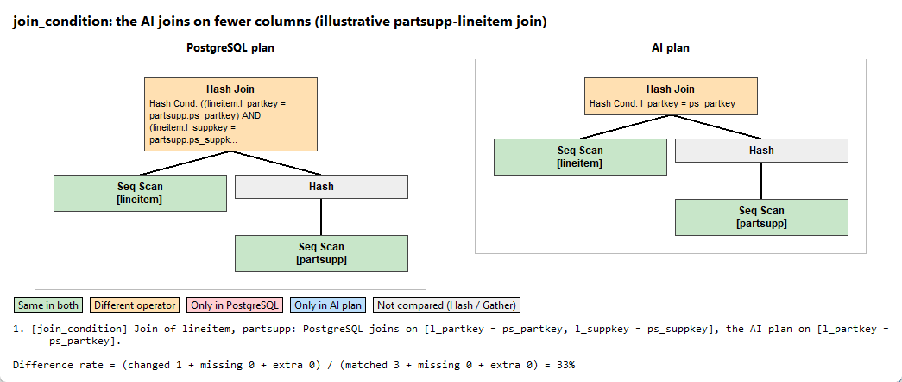

```
1. [join_condition] Join of lineitem, partsupp: PostgreSQL joins on [l_partkey = ps_partkey, l_suppkey = ps_suppkey], the AI plan on [l_partkey = ps_partkey].

Difference rate = (changed 1 + missing 0 + extra 0) / (matched 3 + missing 0 + extra 0) = 33%
```

#### aggregate_strategy

PostgreSQL's 'Aggregate' with Strategy 'Sorted' becomes GroupAggregate when parsed. The Sort nodes sit at different depths but both are keyed (Sort, {lineitem}), so they still match: matching does not depend on position in the tree.

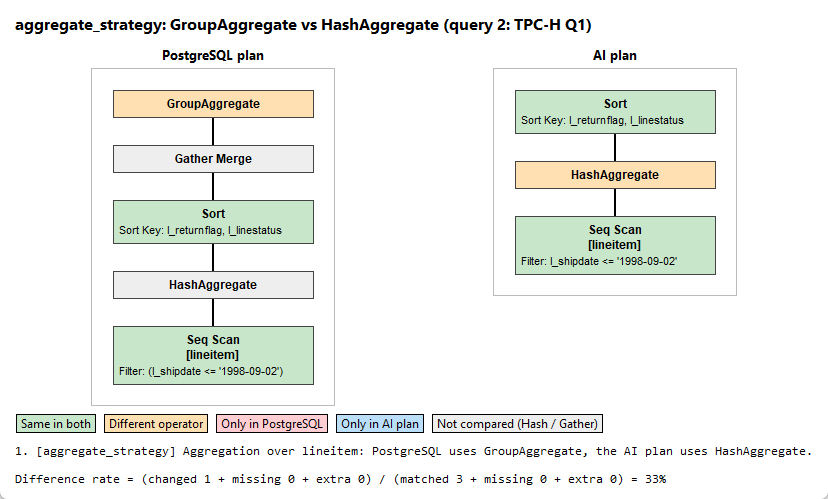

```
1. [aggregate_strategy] Aggregation over lineitem: PostgreSQL uses GroupAggregate, the AI plan uses HashAggregate.

Difference rate = (changed 1 + missing 0 + extra 0) / (matched 3 + missing 0 + extra 0) = 33%
```

#### join_order

The inner joins are keyed by the tables beneath them: {customer, orders} in PostgreSQL's plan and {lineitem, orders} in the AI plan. Neither has a partner, so each is reported as join_order. The top join still matches; its three differences are counted as ONE changed node.

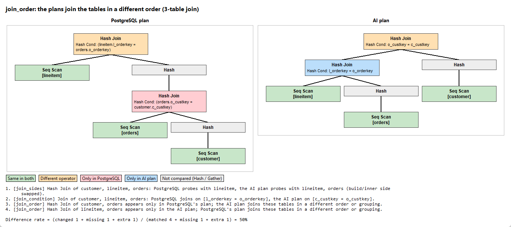

```
1. [join_sides] Hash Join of customer, lineitem, orders: PostgreSQL probes with lineitem, the AI plan probes with lineitem, orders (build/inner side swapped).
2. [join_condition] Join of customer, lineitem, orders: PostgreSQL joins on [l_orderkey = o_orderkey], the AI plan on [c_custkey = o_custkey].
3. [join_order] Hash Join of customer, orders appears only in PostgreSQL's plan; the AI plan joins these tables in a different order or grouping.
4. [join_order] Hash Join of lineitem, orders appears only in the AI plan; PostgreSQL's plan joins these tables in a different order or grouping.

Difference rate = (changed 1 + missing 1 + extra 1) / (matched 4 + missing 1 + extra 1) = 50%
```

#### operator_missing / operator_extra

The AI forgot the LIMIT (red: only in PostgreSQL) and de-duplicates the subquery with an extra HashAggregate (blue: only in the AI plan).

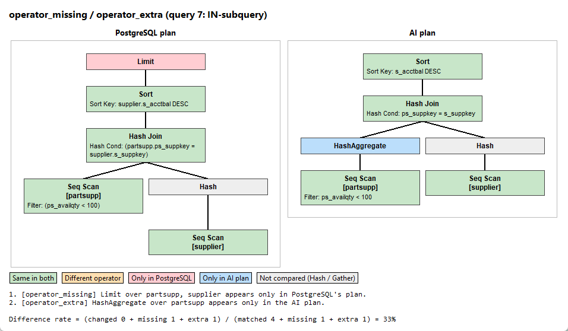

```
1. [operator_missing] Limit over partsupp, supplier appears only in PostgreSQL's plan.
2. [operator_extra] HashAggregate over partsupp appears only in the AI plan.

Difference rate = (changed 0 + missing 1 + extra 1) / (matched 4 + missing 1 + extra 1) = 33%
```

## Step 7: Difference rate (`ComparisonResult.rate`)

```python
    @property
    def rate(self) -> float:
        total = self.matched + self.missing + self.extra
        return (self.changed + self.missing + self.extra) / total if total else 0.0
```

For the Q14 running example:

```
Difference rate = (changed 1 + missing 0 + extra 0) / (matched 4 + missing 0 + extra 0) = 25%
```

A node with several differences counts once (see the join_order gallery example: three differences on one join, one changed node). Ignored helper nodes are in neither the numerator nor the denominator.

## Worked example: TPC-H Q5 with a real Gemini reply

```sql
SELECT n_name, sum(l_extendedprice * (1 - l_discount)) AS revenue
FROM customer, orders, lineitem, supplier, nation
WHERE c_custkey = o_custkey AND l_orderkey = o_orderkey AND l_suppkey = s_suppkey
  AND c_nationkey = s_nationkey AND s_nationkey = n_nationkey
  AND o_orderdate >= date '1994-01-01' AND o_orderdate < date '1995-01-01'
GROUP BY n_name
ORDER BY revenue DESC;
```

Gemini model `gemini-3.1-flash-lite`, prompt without table statistics. The reply was read from the cache, so no API call was made.

_(The cached reply was produced with an earlier version of the prompt template that differed only in trailing whitespace.)_

```
PostgreSQL plan:
Sort
  GroupAggregate
    Gather Merge
      GroupAggregate
        Sort
          Hash Join  (Hash Cond: (customer.c_nationkey = nation.n_nationkey))
            Hash Join  (Hash Cond: ((lineitem.l_suppkey = supplier.s_suppkey) AND (customer.c_nationkey = supplier.s_nationkey)))
              Hash Join  (Hash Cond: (orders.o_custkey = customer.c_custkey))
                Hash Join  (Hash Cond: (lineitem.l_orderkey = orders.o_orderkey))
                  Seq Scan [lineitem]
                  Hash
                    Seq Scan [orders]  (Filter: ((o_orderdate >= '1994-01-01'::date) AND (o_orderdate < '1995-01-01'::date)))
                Hash
                  Seq Scan [customer]
              Hash
                Seq Scan [supplier]
            Hash
              Seq Scan [nation]

Gemini plan:
Sort
  HashAggregate
    Hash Join  (Hash Cond: (s.s_nationkey = n.n_nationkey))
      Hash Join  (Hash Cond: (l.l_suppkey = s.s_suppkey))
        Hash Join  (Hash Cond: (l.l_orderkey = o.o_orderkey))
          Seq Scan [lineitem]
          Hash
            Hash Join  (Hash Cond: (o.o_custkey = c.c_custkey))
              Seq Scan [orders]  (Filter: (o_orderdate >= '1994-01-01'::date) AND (o_orderdate < '1995-01-01'::date))
              Hash
                Seq Scan [customer]
        Hash
          Hash Join  (Hash Cond: (s.s_nationkey = c.c_nationkey))
            Seq Scan [supplier]
            Hash
              Seq Scan [customer]
      Hash
        Seq Scan [nation]
```

Matching keys:

| Key | PostgreSQL | Gemini | Outcome |
|---|---|---|---|
| `(Sort, {customer, lineitem, nation, orders, supplier})` | Sort | Sort | unchanged |
| `(aggregate, {customer, lineitem, nation, orders, supplier})` | GroupAggregate | HashAggregate | changed |
| `(Sort, {customer, lineitem, nation, orders, supplier}) #1` | Sort | - | missing |
| `(join, {customer, lineitem, nation, orders, supplier})` | Hash Join | Hash Join | changed |
| `(join, {customer, lineitem, orders, supplier})` | Hash Join | Hash Join | changed |
| `(join, {customer, lineitem, orders})` | Hash Join | Hash Join | changed |
| `(join, {lineitem, orders})` | Hash Join | - | missing |
| `(scan, lineitem)` | Seq Scan | Seq Scan | unchanged |
| `(scan, orders)` | Seq Scan | Seq Scan | unchanged |
| `(scan, customer)` | Seq Scan | Seq Scan | unchanged |
| `(scan, supplier)` | Seq Scan | Seq Scan | unchanged |
| `(scan, nation)` | Seq Scan | Seq Scan | unchanged |
| `(join, {customer, orders})` | - | Hash Join | extra |
| `(join, {customer, supplier})` | - | Hash Join | extra |
| `(scan, customer) #1` | - | Seq Scan | extra |

```
1. [aggregate_strategy] Aggregation over customer, lineitem, nation, orders, supplier: PostgreSQL uses GroupAggregate, the AI plan uses HashAggregate.
2. [operator_missing] Sort over customer, lineitem, nation, orders, supplier appears only in PostgreSQL's plan.
3. [join_condition] Join of customer, lineitem, nation, orders, supplier: PostgreSQL joins on [c_nationkey = n_nationkey], the AI plan on [n_nationkey = s_nationkey].
4. [join_condition] Join of customer, lineitem, orders, supplier: PostgreSQL joins on [c_nationkey = s_nationkey, l_suppkey = s_suppkey], the AI plan on [l_suppkey = s_suppkey].
5. [join_sides] Hash Join of customer, lineitem, orders: PostgreSQL probes with lineitem, orders, the AI plan probes with lineitem (build/inner side swapped).
6. [join_condition] Join of customer, lineitem, orders: PostgreSQL joins on [c_custkey = o_custkey], the AI plan on [l_orderkey = o_orderkey].
7. [join_order] Hash Join of lineitem, orders appears only in PostgreSQL's plan; the AI plan joins these tables in a different order or grouping.
8. [join_order] Hash Join of customer, orders appears only in the AI plan; PostgreSQL's plan joins these tables in a different order or grouping.
9. [join_order] Hash Join of customer, supplier appears only in the AI plan; PostgreSQL's plan joins these tables in a different order or grouping.
10. [operator_extra] Seq Scan on 'customer' appears only in the AI plan.

Difference rate = (changed 4 + missing 2 + extra 3) / (matched 10 + missing 2 + extra 3) = 60%
```

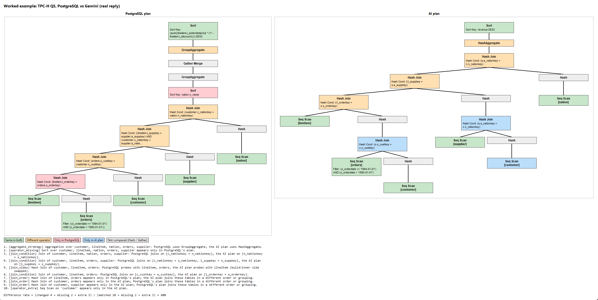

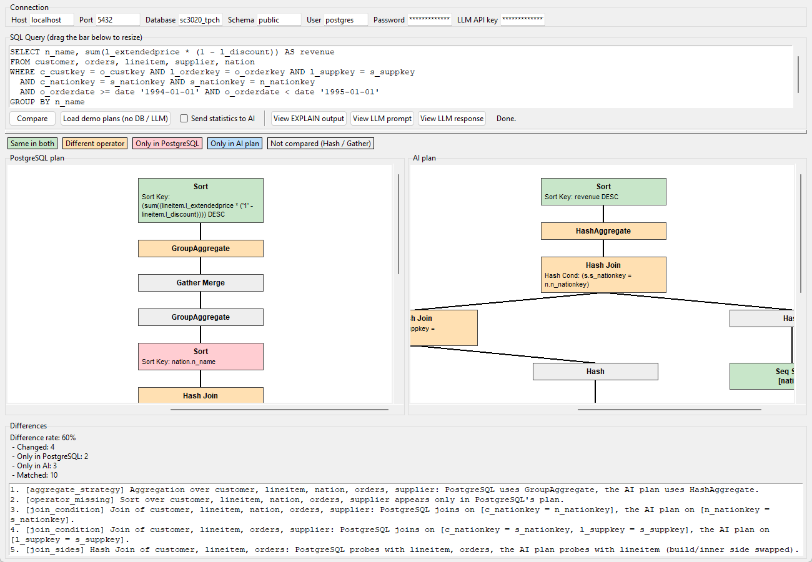

*Figure: the GUI after comparing TPC-H Q5.*

